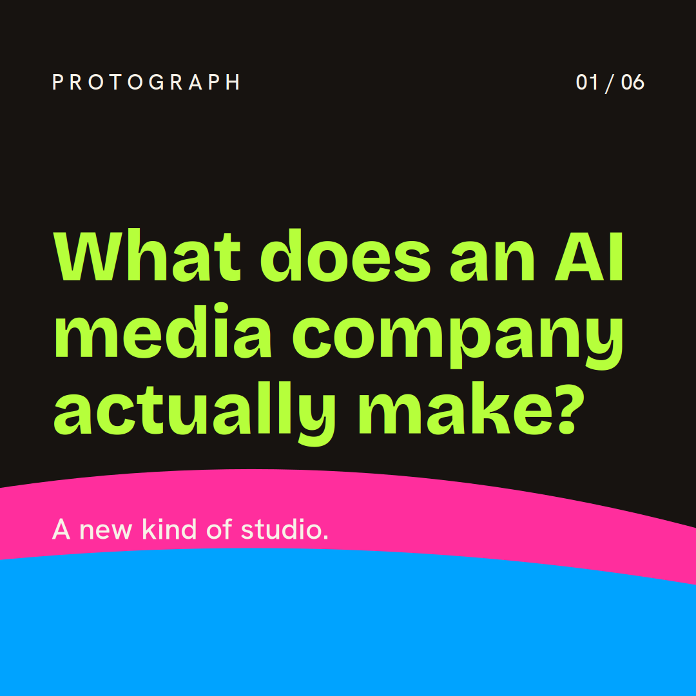
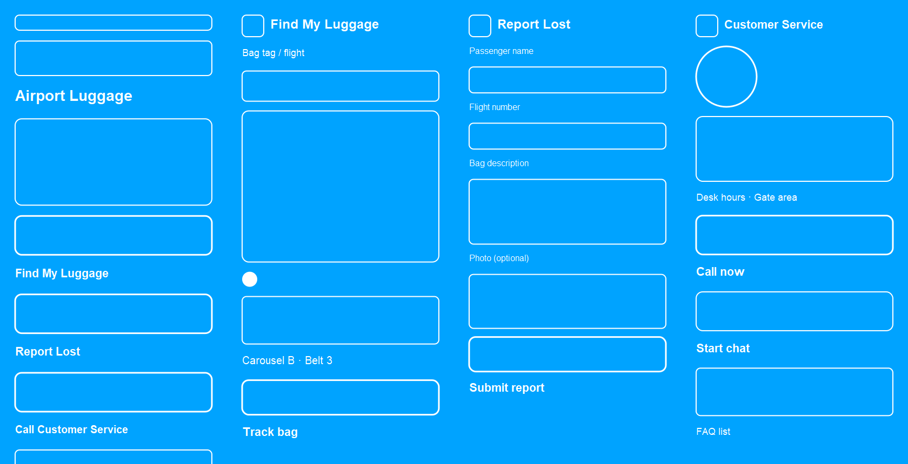

# Etch — "Etch-A-Sketch for AI" (working title)

[](LICENSE)
[](https://github.com/grafkendo/sketchai/actions/workflows/ci.yml)

A service that lets **AI agents draw** — composing storyboards, slides, and
social graphics from vector components instead of full prompt-to-image renders.

**Thesis:** agents should sketch like draftsmen (vectors + real fonts),
not like painters (pixels + luck). Far less compute, deterministic editing,
real fonts, surgical revisions.

**Model:** open core (MIT) + hosted SaaS. The engine and MCP server are free
for everyone; revenue comes from the managed cloud, pack marketplace, and
enterprise tiers.

## Quickstart

```bash
git clone https://github.com/grafkendo/sketchai.git
cd sketchai
python -m venv engine/.venv
engine/.venv/bin/pip install -r engine/requirements.txt
cd engine && ../engine/.venv/bin/python test_mcp.py   # 12/12 green = you're live
```

> **Windows:** `cairosvg` needs the native Cairo library. Install the GTK3
> runtime from
> https://github.com/tschoonj/GTK-for-Windows-Runtime-Environment-Installer/releases
> (tick **"Set up PATH"**), restart your terminal, then run the tests.

To give your agent the tools, point any MCP client at the server over stdio:

```json
{
  "mcpServers": {
    "etch": {
      "command": "/path/to/sketchai/engine/.venv/bin/python",
      "args": ["/path/to/sketchai/engine/mcp_server.py"]
    }
  }
}
```

Full client setup (Claude Code, Cursor, generic): [engine/MCP.md](engine/MCP.md).

## Demo

A 6-slide branded carousel composed programmatically, then a surgical edit
(headline + accent color changed on slide 3 only — everything else
byte-identical):


*Slide 1 of the demo carousel — real Bricolage Grotesque type, exact brand hexes*


*The first render driven by an agent in Cursor: composed "HELLO", then edited to magenta*


*An agent-composed wireframe storyboard (added Oct 18, 2026): four app screens — Airport Luggage home, Find My Luggage, Report Lost, and Customer Service — sketched as vector components with real type, form fields, and navigation in one sequence. This is what Etch is for beyond slides: cheap, editable UI sketching before any code is written.*

## Docs

- [Agent Guide](AGENT_GUIDE.md) — **instructions for AI agents using Etch**, including a paste-in directive for system prompts / Cursor rules / project instructions.
- [Test Cases](TEST_CASES.md) — 10 hands-on prompts with pass/fail checks.
- [Whitepaper](whitepaper/etch-a-sketch-for-ai.md) — the argument: why agents
  can't draw, the composition-over-generation thesis, architecture, economics,
  and the open-core model.
- [Service spec](specs/sketch-service-spec.md) — API surface (`sketch.compose` /
  `sketch.edit` / `sketch.sequence`), component model, brand-token enforcement,
  deterministic edit/re-render loop, metering, risks.
- [Roadmap](ROADMAP.md) — phased build plan: spike → MVP API → MCP-native →
  storyboards/packs/billing → distribution.
- [Landscape research](research/landscape-report.md) — market and competitive
  research behind the spec.

## Status

Spec + research + whitepaper complete (Oct 2026). **Phase 0+1 engine built
(Oct 12, 2026):** `engine/` holds the deterministic render core — 14 typed
components, constraint/flow layout, brand-token enforcement at render time,
content-hashed compose/edit loop, FastAPI service (`POST /v1/renders`,
`PATCH /v1/renders/{id}`), CLI, and a 6-slide demo proving surgical edits
(`engine/demo_out/`). **Phase 2 MCP server built (Oct 12, 2026):** `engine/mcp_server.py`
exposes 8 tools over stdio (`sketch_compose/edit/sequence`, `components_list`,
`brand_apply`/`brand_validate`, `assets_upload`, `fonts_list`) — 12/12 tool tests
green; `engine/MCP.md` has client setup docs; `smithery.yaml` + `Dockerfile` +
`server.json` + `PUBLISHING.md` ready for registry publishing (needs repo public
+ his accounts). **Open-source prep done (Oct 13, 2026):** MIT `LICENSE`,
`CONTRIBUTING.md`, `SECURITY.md`, CI on Linux + Windows
(`.github/workflows/ci.yml`), `pyproject.toml` for `pip install`. Phase 3
(storyboards, packs, hosted SaaS billing) is next. The repo goes public when
the author flips it.

## Also parked (not dropped)

- MCP trust/verification layer for the noisy server registry
- Agent payments/billing rails for marketplaces
