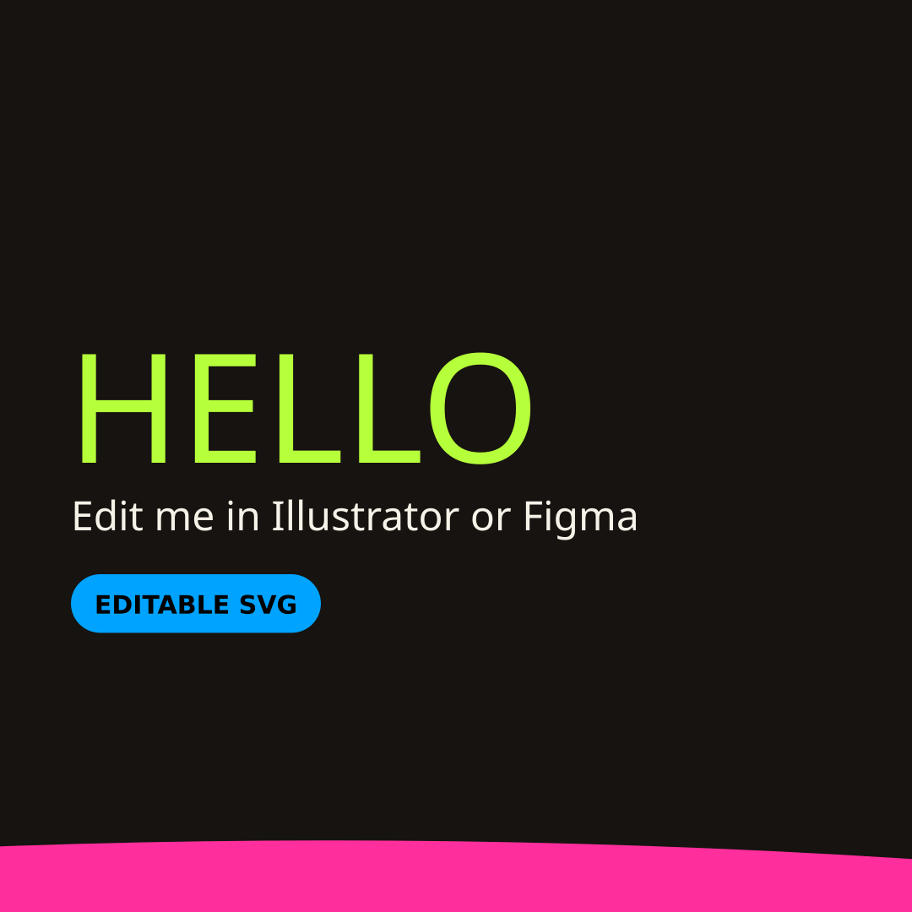
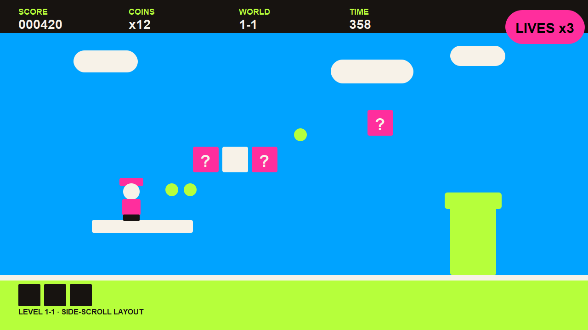

```
    \
   (o>
   _//)
╭───────────────────────────────────────────────────────────────────╮
│                                                                   │
│          ██████████  ██████████    ████████  ██      ██           │
│          ██              ██      ██          ██      ██           │
│          ████████        ██      ██          ██████████           │
│          ██              ██      ██          ██      ██           │
│          ██████████      ██        ████████  ██      ██           │
│                                                                   │
│                       /\_/\          (o)(o)                       │
│                     ( o.o )         (  __  )                      │
│                      > ^ <           (____)                       │
│                                      _|  |_                       │
│    d e t e r m i n i s t i c   v e c t o r   s k e t c h i n g    │
│                     f o r   a i   a g e n t s                     │
│                              v0.3.0                               │
│                                                                   │
│ ( ◉ )                                                       ( ◉ ) │
╰───────────────────────────────────────────────────────────────────╯
```

# Etch — "Etch-A-Sketch for AI" (working title)

[](LICENSE)
[](https://github.com/grafkendo/sketchai/actions/workflows/ci.yml)

A service that lets **AI agents draw** — composing storyboards, slides, and
social graphics from vector components instead of full prompt-to-image renders.

**Thesis:** agents should sketch like draftsmen (vectors + real fonts),
not like painters (pixels + luck). Far less compute, deterministic editing,
real fonts, surgical revisions.

## ✏️ Editable in Illustrator & Figma — not a flat picture

Every Etch render is a **real SVG file first**, and a PNG second. The SVG is
the source of truth, so anything Etch makes can be opened and manipulated in
professional design tools:

- **Adobe Illustrator:** open the `.svg` (or the PDF export) directly — every shape is a real vector.
- **Figma:** drag the `.svg` onto the canvas — it imports as editable vector and text layers.
- **Text stays text.** Headlines are real `<text>` elements in a named font (not outlines, not pixels), so you can retype them in either tool.
- **Every component is a named layer.** A node's `node_id` becomes its SVG id/group (`s1-head`, `s1-curve`, …), so pieces arrive labeled, not as anonymous blobs.
- **Fonts travel with the repo** in `engine/fonts/` (Bricolage Grotesque + Hanken Grotesk). Install those, or Illustrator/Figma will substitute a fallback font.
- One honest limit: Etch's stack/grid layout becomes flat positions in the SVG. Moving a piece in Figma won't reflow the rest — for reflow-style edits, use Etch's own `sketch_edit`, then re-export.

Try it: download [`examples/hello-editable.svg`](examples/hello-editable.svg), drag it into Figma or open it in Illustrator, and retype the headline.

**Model:** open core (MIT) + hosted SaaS. The engine and MCP server are free
for everyone; revenue comes from the managed cloud, pack marketplace, and
enterprise tiers.

## Quickstart

```bash
git clone https://github.com/grafkendo/sketchai.git
cd sketchai
python -m venv engine/.venv
engine/.venv/bin/pip install -r engine/requirements.txt
cd engine && ../engine/.venv/bin/python test_mcp.py   # all green = you're live
```

> **Windows:** `cairosvg` needs the native Cairo library. Install the GTK3
> runtime from
> https://github.com/tschoonj/GTK-for-Windows-Runtime-Environment-Installer/releases
> (tick **"Set up PATH"**), restart your terminal, then run the tests.

To give your agent the tools, point any MCP client at the server over stdio:

```json
{
  "mcpServers": {
    "etch": {
      "command": "/path/to/sketchai/engine/.venv/bin/python",
      "args": ["/path/to/sketchai/engine/mcp_server.py"]
    }
  }
}
```

Full client setup (Claude Code, Cursor, generic): [engine/MCP.md](engine/MCP.md).

## Demo

A 6-slide branded carousel composed programmatically, then a surgical edit
(headline + accent color changed on slide 3 only — everything else
byte-identical):


*Slide 1 of the demo carousel — real Bricolage Grotesque type, exact brand hexes*


*The first render driven by an agent in Cursor: composed "HELLO", then edited to magenta*


*The same kind of render as an editable SVG: [examples/hello-editable.svg](examples/hello-editable.svg) — download it and open it in Illustrator or Figma. The headline is live text, and every element is a named, movable layer.*


*An agent-composed game level layout (1280×720): HUD with score / coins / world / time, a lives badge, platforms, question blocks, coins, a character, and a pipe — all vector components with real type. Etch works for level design and storyboarding, not just slides.*

## Docs

- [Agent Guide](AGENT_GUIDE.md) — **instructions for AI agents using Etch**, including a paste-in directive for system prompts / Cursor rules / project instructions.
- [Test Cases](TEST_CASES.md) — 10 hands-on prompts with pass/fail checks.
- [Whitepaper](whitepaper/etch-a-sketch-for-ai.md) — the argument: why agents
  can't draw, the composition-over-generation thesis, architecture, economics,
  and the open-core model.
- [Service spec](specs/sketch-service-spec.md) — API surface (`sketch.compose` /
  `sketch.edit` / `sketch.sequence`), component model, brand-token enforcement,
  deterministic edit/re-render loop, metering, risks.
- [Roadmap](ROADMAP.md) — phased build plan: spike → MVP API → MCP-native →
  storyboards/packs/billing → distribution.
- [Landscape research](research/landscape-report.md) — market and competitive
  research behind the spec.

## Status

**v0.3.0 — working and tested.** All 10 engine test suites pass.

- **Engine (Phase 0+1, Oct 12, 2026):** deterministic render core in
  `engine/` — 14 typed components, constraint/flow layout, brand-token
  enforcement at render time (palette, fonts, no-pure-black, WCAG contrast,
  max-colors), content-hashed compose/edit loop, FastAPI service, CLI, and a
  6-slide demo proving surgical edits (`engine/demo_out/`).
- **MCP server (Phase 2, Oct 12–13, 2026):** `engine/mcp_server.py` exposes
  **14 tools** over stdio — compose / edit / sequence / batch / from-pack,
  visual diff, animation (deterministic GIFs), signed provenance manifests,
  component packs, brand apply/validate, components/fonts listing, and asset
  upload. Also includes a hosted HTTP mode with API-key auth and per-render
  credit metering, and a diffusion bridge that drops generated images into
  image slots. Client setup: `engine/MCP.md`.
- **Open source (Oct 13, 2026):** MIT `LICENSE`, `CONTRIBUTING.md`,
  `SECURITY.md`, `pyproject.toml` (`pip install` gives you the `etch-mcp`
  command), `smithery.yaml` + `Dockerfile` + `server.json` for registry
  publishing (see `PUBLISHING.md`). The two bundled fonts (Bricolage
  Grotesque, Hanken Grotesk) are separately licensed under the SIL Open Font
  License — see `engine/fonts/OFL.txt`.
- **Lean responses:** render tools write the PNG and SVG to disk and
  return paths plus `render_id` / `content_hash` by default, so a compose
  costs the calling model ~2k context tokens instead of ~10–20k.
  Base64-inlining is still available as an opt-in (`include_png=true`)
  for clients without filesystem access.
- **Next:** registry distribution (Smithery, the official MCP registry,
  directories). Hosted SaaS + billing is a later phase, not yet built.

## Also parked (not dropped)

- MCP trust/verification layer for the noisy server registry
- Agent payments/billing rails for marketplaces
